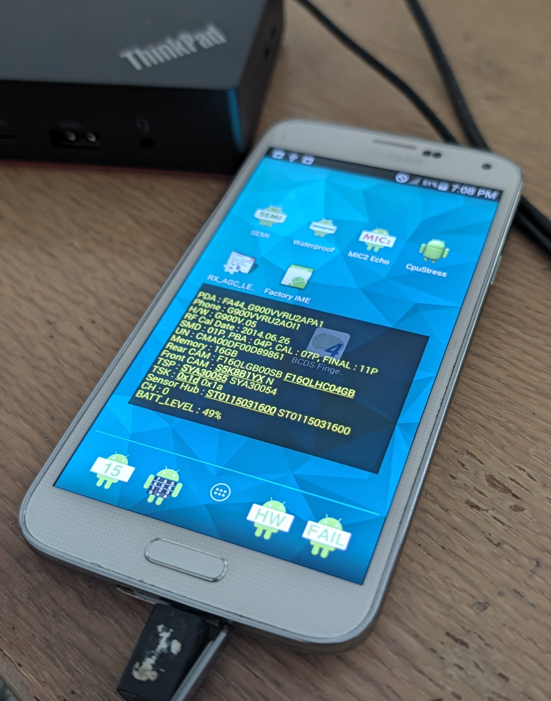
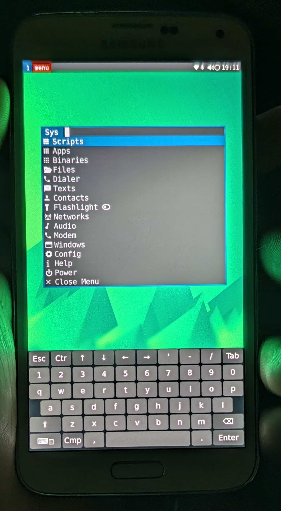
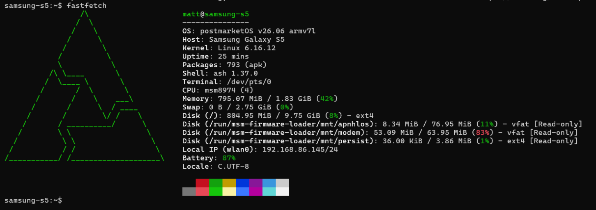

# Galaxy S5 Revival

Revived a 2014 Verizon Galaxy S5: unlocked the bootloader, evaluated postmarketOS against LineageOS on measured RAM and hardware support, shipped LineageOS 15.1, and diagnosed a boot-order race condition in the Settings app. Skills: Android/Linux internals, shell scripting, flashing tools, debugging from logs

E-waste makes me sad. 

I've always had a talent to bring new life to old or broken things. Whether it be repairing countless iPhones in the summers after high school, learning to use an Apple IIe (circa 1983) after soldering in new PSU capacitors, or buying out a local PC repair business liquidation in 2016, loading up my mom's Subaru Outback to the brim with 100+ laptops of various functionality to restore, upgrade and resell to fund my first stint at college.

## Specs:

2014 Samsung Galaxy S5, Verizon 
    Model: SM-G900V / kltev
    Chipset: Qualcomm Snapdragon 801, 4 cores (ARMv7) up to 2.5Ghz / 2GB RAM
    Storage: 32GB internal eMMC flash
    Camera: Front 2.3MP / Rear 16MP

Fun extras:
    LED IR Blaster, NFC, Bluetooth, Fingerprint scanner, 
    Broadcom BCM4354 WiFi Chipset

## Project Scope:

Android 8.1 / LineageOS 15.1: Android 8.1 offers the best balance of optimization, stability and app compatability for the S5. LineageOS 15.1 takes it to another level, allowing us to further tailor the OS to our use cases.

IR Blaster: Lots of utility here for me at work. Can save me time configuring retail TVs, and can be used at home with my TV.

## What's Next:

Broadcom BCM4354 WiFi chipset: The BCM4354 lacks native "monitor mode" support in most Linux kernels. 

Monitor mode, aka RFMON, is a hardware mode that turns off a WiFi chip's address filtering. This allows the OS to see traffic not addressed to a device's MAC address, instead of dropping it. 

For fun, we're going to recompile the LineageOS kernel and add driver modules that allow us to (legally) explore the networks around us.

## Unlocking a locked bootloader:

## Getting a custom OS onto a locked phone

The Verizon S5 ships with a locked bootloader. I used the CID15 exploit and flashed an engineering test build of Android, which boots into Samsung's factory test environment (shown below). It's mostly a hardware readout with misc. testing apps.

## Round One: postmarketOS

I started with postmarketOS (based on Alpine Linux) and Sxmo (a minimal UI using Sway window manager) running on Wayland. Alpine Linux is known for very low overhead, and I initially thought it would be best for limited resources, but found the real world usability limited.

It booted and the interface worked, but a lot of the phone didn't. The Sxmo menu has entries for all of the hardware, but most features weren't functional on this kernel. That's a lot to give up for real world usability.

After probing for working hardware IDs and binding them to the toggle scripts in Sxmo, testing measured postmarketOS using **~820 MB of RAM** (converted from MiB shown above) with the compositor, on screen keyboard, Sxmo daemons, etc as overhead. I wanted to see the resources we gained by going headless, without any graphics.

I reflashed postmarketOS without graphical interfaces and ran the phone headless to see how much RAM the base system really needs. It came down to **~330 MB**, which matched my expectations. As a proof that the hardware was usable without a UI, I made the phone's green status LED blink as a "heartbeat" while the system is up. The kernel for this port was built without the `timer` and `heartbeat` LED triggers, so I had to get a little creative implenting this. Instead, [`files/led-heartbeat.sh`](files/led-heartbeat.sh) turns the trigger off and flashes the LED for 0.2 s every 3 seconds. I used OpenRC's `local` service so it started at boot. If the light stopped, I knew that the phone was frozen or off.

## Round Two: LineageOS 15.1

I did some research and decided that LineageOS 15.1 (mainly based on Android 8.1) would be the best OS for optimizing both available features and performance. Having an official kernel also meant that all of our hardware works, which is worth the minor increases in resource overhead. 

First, I compared Low RAM mode on and off at idle, finding only a ~40MB difference in usage. I decided to leave it off, reasoning that it would be acceptable as I'm not planning any resource intensive use cases like multi-window multitasking or gaming.

|                       | postmarketOS + Sxmo              | LineageOS 15.1 (Android 8.1)                            |
| --------------------- | -------------------------------- | ------------------------------------------------------- |
| Kernel                | mainline Linux 6.16              | vendor Linux 3.4                                        |
| Memory used, full UI  | ~820 MB idle Sxmo on Wayland | ~390-430 MB idle Full Android UI/launcher           |
| Memory used, headless | ~330 MB (Sxmo removed)           | n/a                                                     |
| Flashlight            | broken                           | working                                                 |
| Cellular modem        | broken                           | working  (not usable with modern cell towers)       |
| NFC                   | broken                           | working                                                 |
| IR blaster            | broken                           | working                                                 |
| Camera                | broken                           | working                                                 |

The headless number shows how light Alpine is without a UI, but the phone is significantly more useful with LineageOS.

<!-- TODO(matt): the heartbeat script is recovered from your claude.ai chat (led-heartbeat.sh). The ~330 MB headless number comes from your memory; the part of the shared chat I could read doesn't show it. -->

## LineageOS Install and Tuning:

- **Installed LineageOS 15.1** with `heimdall` (open source version of Samsung's Odin flashing tool), TWRP (replaces stock recovery image to load custom ROM) and `adb`. Before wiping anything I backed up the EFS and boot partitions and verified the checksums.
- **Debloated** 17 system apps and generated a restore script. Privileged apps reinstalled themselves after a reboot, so those are disabled per user instead of removed.
- **Tuned it:** animations at 0.5x, a black theme for the AMOLED screen, and system night mode so apps follow the theme.
- **Measured the battery.** Overnight with airplane mode on and Wi-Fi on, standby draws about 14 mAh/h, roughly 8 days.
- **Set up an IR remote** and loaded profiles for my TV and retail Samsung displays I interact with at work.

## Problems:

**Picking a dark mode crashed Settings.** LineageOS's style service starts about 0.4 s before the overlay manager finishes initializing, so choosing a style threw a null pointer error. I confirmed it from the order of the boot log and ruled out my debloating and low-RAM mode. The workaround was to write style settings directly with root and enable the overlay.

**The IR app crashed on launch.** The F-Droid build of the Flutter-based app has no 32-bit `libflutter.so`, meaning libraries were missing. The project's GitHub `armeabi-v7a` build does, and everything worked once I switched.

## The postmarketOS files

- `detect-klte-profile.sh`: dumps device values to build a Sxmo profile
- `sxmo_deviceprofile_samsung,klte.sh`: Sxmo device profile (buttons, display, LEDs, Wi-Fi)
- `led-heartbeat.sh`: blinks the green status LED every 3 s as a "system is alive" heartbeat so I could tell the headless phone was still up
- `etc/udev/rules.d/90-klte-touchscreen.rules`: stable touchscreen device path for `lisgd`(allowing gestures to work in Sxmo). Added to `etc/udev/rules.d/`

## Tools

`heimdall`, `adb`, TWRP, LineageOS 15.1, Termux, F-Droid, shell scripting.

